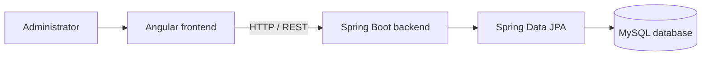

# Employee Management System

A full-stack employee-management application built with **Angular**, **Spring Boot**, and **MySQL**. The UI includes employee listing, employee details, create/update/delete flows and an admin login screen.

## Features represented in the project

- View employee records and individual employee details
- Add, update and delete employee records
- Angular frontend with form-based interactions
- Spring Boot REST backend
- MySQL relational database integration
- Screenshots in the `ScreenShots/` directory

> **Security note:** the presence of an admin login screen does not by itself establish production-grade authentication or authorization. Verify the implementation before using this project with real employee data.

## Architecture



## Technology stack

| Layer | Technology |
|---|---|
| Frontend | Angular 16, TypeScript, Angular Material, Bootstrap |
| Backend | Java 17, Spring Boot 3 |
| Persistence | Spring Data JPA / Hibernate |
| Database | MySQL |
| Build tools | npm and Maven Wrapper |

## Repository layout

```text
.
├── emp_backend/                    # Spring Boot application
│   ├── mvnw
│   ├── mvnw.cmd
│   └── pom.xml
├── employee frontend final/        # Angular application
│   ├── angular.json
│   ├── package.json
│   └── src/
└── ScreenShots/                    # Project screenshots
```

## Run locally

### Prerequisites
- JDK 17
- Node.js and npm
- MySQL Server

### 1. Configure MySQL and backend
Create a database in MySQL, then configure the backend's datasource URL, username, password and any required JPA settings in the Spring Boot configuration file under `emp_backend/src/main/resources/`.

**Do not commit real database passwords or production secrets.**

From the repository root:

**Windows**
```powershell
cd emp_backend
.\mvnw.cmd spring-boot:run
```

**macOS / Linux**
```bash
cd emp_backend
./mvnw spring-boot:run
```

### 2. Start the Angular frontend
Open a second terminal:

```bash
cd "employee frontend final"
npm install
npm start
```

Angular CLI prints the local URL when the development server starts. Confirm the backend API URL and CORS settings match the frontend configuration.

## Before production use

- Verify authentication and authorization on the backend, not just in the UI.
- Validate inputs and handle API/database errors.
- Keep credentials in environment-specific configuration.
- Add automated tests for employee CRUD operations and API validation.
- Replace externally hosted screenshots with repository-owned screenshots where possible.

## License

No explicit license is currently declared. Contact the repository owner before reusing the code.